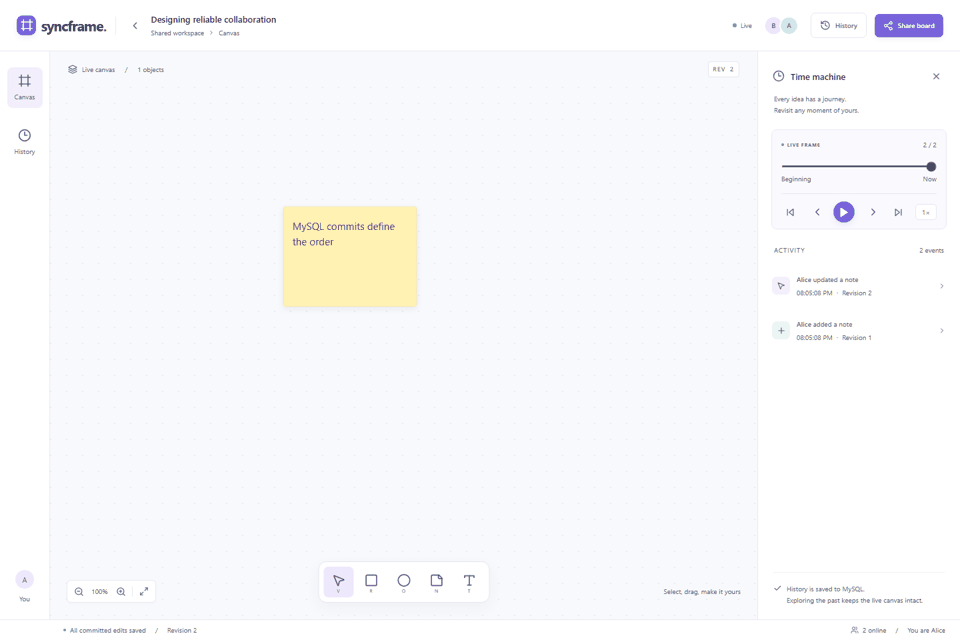
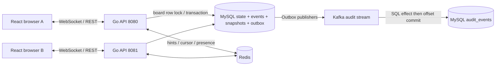

# SYNCFRAME

MySQL Revision을 기준으로 공동 편집과 과거 상태 재생을 제공하는 Go 기반 실시간 화이트보드.

## 배경과 해결하려는 문제

실시간 협업에서 화면에 도형을 전파하는 것보다 어려운 문제는 끊어진 연결과 동시 수정 이후에도 같은 상태로 돌아오는 것이다. SYNCFRAME은 서버가 편집 순서를 결정하고, 승인된 편집을 이벤트로 저장해 현재 상태와 과거 상태를 같은 기록에서 복원한다.

핵심 질문은 세 가지다. **두 서버에서 동시에 편집해도 Revision이 이어지는가? ACK를 잃고 재전송해도 한 번만 적용되는가? Redis·Kafka가 중단되어도 승인한 편집을 복구하는가?** 이 질문을 실제 MySQL, WebSocket, Chromium과 장애 주입으로 검증한다.

## 실행 화면과 시연



GIF는 실제 Chromium 화면 8장의 상태 전환 시연이다. 연속 녹화는 [원본 WebM 영상](artifacts/portfolio/demo/syncframe-demo.webm), 재현 코드는 [브라우저 시연 테스트](web/demo/portfolio.spec.ts)에 있다.

시연 순서: Alice와 Bob이 8080/8081에 접속 → Bob의 이동과 커서 반영 → Alice의 Offline 편집과 pending → Online 복구 → Revision 0부터 재생·현재 위치 Overlay → 라이브 보드 복귀. 시연의 각 단계는 DOM과 영속 상태 assertion을 통과한 화면이다.

## 주요 기능

- 보드 생성·공유, 도형·노트·텍스트, 이동·크기·색상 편집, 키보드 선택·이동·삭제
- 독립 세션 및 여러 Go 서버 사이의 실시간 편집, 커서와 Presence
- 미승인 편집의 로컬 보관, 같은 Operation ID 재전송, 누락 Revision 복구
- 스냅샷과 이벤트를 이용한 읽기 전용 Time Machine, Play/Pause·속도·Overlay
- 편집 트랜잭션과 결합된 MySQL Outbox, Kafka 비동기 감사 및 중복 소비 방지

## 시스템 아키텍처



**MySQL 커밋이 편집 승인 기준**이다. Redis는 새 Revision을 알리는 힌트와 임시 접속 상태를 담당한다. WS writer는 SQL에서 순서대로 이벤트를 읽으며, 알림을 잃어도 1초 polling으로 복구한다. Kafka는 비동기 감사 경로이며 라이브 문서나 이력의 원본이 아니다. [컴포넌트·데이터·API 설계](docs/architecture.md)

## 핵심 기술적 과제와 설계 결정

### 1. 동시 수정과 재전송을 하나의 Revision 이력으로 정리

동시에 다음 번호를 읽으면 중복 Revision이 생기고, ACK 유실 후 재전송하면 편집이 중복될 수 있다. 보드 행을 FOR UPDATE로 잠근 뒤 Operation ID와 fingerprint를 확인하고 state·event·outbox·선택적 snapshot을 한 트랜잭션에서 기록한다.

CRDT보다 서버 규칙과 재현이 단순하지만 인기 보드의 쓰기가 직렬화된다. 같은 필드는 마지막 커밋이 이기며 문자 단위 병합은 하지 않는다. 20개 동시 SQL 편집, 동일 요청 20회 중복, payload 변조와 마지막 Outbox 쓰기 실패의 전체 rollback을 테스트한다. [규칙과 예시](docs/data-consistency.md)

### 2. 휘발성 알림을 잃어도 같은 문서로 복구

Redis Pub/Sub와 WebSocket 연결만으로는 재접속 시 누락을 알 수 없다. 서버는 마지막 Revision 이후의 SQL 이벤트를 다시 읽고, 브라우저는 연속 Revision만 적용한다. Time Machine도 같은 이벤트와 50 Revision 간격 스냅샷으로 복원하며 라이브 state와 분리한다.

연결별 polling은 복구를 단순하게 하지만 조회 비용이 사용자 수에 비례한다. 보드별 공유 poller가 대안이다. 두 서버 협업, 실제 Redis 중단, 브라우저 Offline·재시작, Replay와 SQL 최종 상태 비교로 검증한다. [장애 시 보장 범위](docs/failure-recovery.md)

### 3. 편집 저장과 Kafka 후처리 사이의 이중 쓰기 경계

SQL 커밋 뒤 별도로 Kafka에 보내면 발행 전에 종료된 이벤트를 잃을 수 있다. 편집과 Outbox를 함께 저장하고 별도 worker가 발행한다. Consumer는 감사 SQL을 저장한 뒤 offset을 커밋하고 PK로 재전달의 효과를 중복시키지 않는다.

Kafka ACK와 SQL published 표시는 원자적이지 않아 중복 발행이 가능하다. 여러 publisher는 Revision 순서도 바꿀 수 있다. 따라서 exactly-once를 주장하지 않는다. 실제 브로커 중단·복구, Outbox drain, 중복 produce와 consumer offset을 검증한다. 정확한 crash-window kill과 poison-message 자동 복구는 UNVERIFIED다. [코드 검토와 잔여 위험](docs/review.md)

## 사용 기술과 선택 이유

| 기술 | 선택 이유 | 비용 |
|---|---|---|
| Go / gorilla WebSocket | HTTP와 연결 수명·단일 writer를 직접 제어 | 종료·deadline·backpressure 관리 필요 |
| MySQL / InnoDB | 행 잠금·유일 제약·원자적 편집 저장 | 단일 보드 잠금과 full JSON 쓰기 |
| Redis | 서버 간 힌트·TTL Presence·커서 | 유실 가능, 영속 복구는 SQL 필요 |
| Kafka | 편집 승인과 감사 처리의 장애 경계 분리 | 단일 로컬 브로커, 중복·소비 지연 관리 |
| React / TypeScript / SVG | 편집·이력 상태 분리, DOM 기반 검증 | 대형 문서 렌더링에 한계 |
| Playwright / Docker Compose | 실제 브라우저와 인프라의 재현 가능한 검증 | 로컬 자원·환경에 따른 성능 편차 |

Kafka는 이 규모의 화이트보드에 필수인 기술은 아니다. SQL 감사만으로도 더 단순하게 구성할 수 있다. 이 프로젝트에서는 비동기 발행·재전달·소비 경계를 구체적으로 다룬다. [선택하지 않은 대안](docs/tradeoffs.md)

## 실행 방법

필수: Docker Desktop/Engine + Compose. 소스 테스트는 Go 1.26.10+, Node 24+를 사용한다. 외부 API 키는 필요하지 않다.

```sh
docker compose --profile multi up -d --build --wait --wait-timeout 180
```

[localhost:8080](http://localhost:8080)에서 New board 또는 editable starter board를 연다. Share board의 링크로 독립 브라우저를 연결한다. 두 번째 서버는 [localhost:8081](http://localhost:8081)이다. 공유 링크의 capability는 편집 권한이므로 공개 문서·이슈에 게시하지 않는다.

`.env.example`로 포트를 변경할 수 있다. Compose는 loopback에만 바인딩하며 고정 DB 비밀번호는 공개된 로컬 데모 값이다. 인터넷 공개 배포용 자격증명이 아니다. 테이블은 내장 schema로 초기화하며 운영 DDL migration 도구는 포함하지 않는다.

```sh
docker compose --profile multi down
```

종료 후 MySQL·Kafka 볼륨은 유지된다.

## 테스트 및 성능 측정

실제 DB·단위·Chromium 전체 E2E·보안 검사·컨테이너 장애 회귀:

```powershell
./scripts/browser-qa.ps1 -RunId portfolio-final-20261024
```

환경 변수가 없는 `go test ./...`는 인프라 테스트를 건너뛰므로 전체 검증으로 간주하지 않는다. [명령·최신 결과](docs/testing.md) · [브라우저 시나리오·실패 재현](docs/browser-qa.md)

20·50·100명 조건과 20명·5분 지속 부하는 같은 보드의 실제 WebSocket/SQL 경로로 측정한다. **ACK는 SQL 커밋 왕복 지연이며 브라우저 렌더링 지연이 아니다.** 실측 표, 원본 JSON, 자원 조건과 실패율은 [성능 실험](docs/performance.md)에 있다. 최종 단기 측정에서 100명 p95는 약 1.74초로 늘었다. 사용자 수 증가를 처리 가능 인원이나 운영 SLA로 해석하지 않는다.

| 검증 | 결과 |
|---|---|
| Go 실제 DB/API/WS · frontend | 9개 · 5개 통과 |
| Chromium · 실제 인프라 장애 | 13개(59.3s) · Redis/Kafka/Go 회귀(68.19s) 통과 |
| 동일 보드 20 / 50 / 100명 | 162.69 / 132.31 / 124.32 edits/s, 관측 실패 0건 |
| 20명·5분·사용자당 1Hz | 6,000건, ACK p95 169.16ms, 모든 socket·Replay·SQL 일치 |

공개 전 동일 회귀를 반복해 Chromium 13개(65.8s)와 실제 장애 회귀(70.80s)를 재확인했다. [반복 검증 근거](artifacts/publication/validation.json)

코드와 테스트를 면접에서 따라갈 수 있도록 [프로젝트 요약·도전 과제·예상 질문·구현 근거](docs/portfolio.md)를 정리했다. [공개 전 민감정보 점검](docs/publication.md)은 로컬 Git 이력과 Trace를 포함한다.

## 설계상 한계와 개선 방향

- 필드 단위 마지막 커밋 우선이다. 오래된 오프라인 patch가 최신 값을 덮을 수 있다. 더 엄격한 충돌 처리는 필드 버전 조건이나 CRDT가 대안이다.
- 보드당 500개 lifetime ID(삭제 포함), 100,000 이벤트, API 인스턴스당 200개 WS로 제한한다. full JSON 쓰기·보드 잠금·연결별 polling이 확장 비용이다.
- Consumer poison message 격리·감시, 보존·compaction, DB/브로커 HA는 없다. 감사 정지가 readiness에 반영되지 않는다.
- 익명 capability 모델이며 이름은 표시명이다. 계정·RBAC·링크 철회·운영 TLS/SASL은 별도 설계가 필요하다.
- 실제 모바일 장비·Firefox/WebKit·스크린리더·WAN 손실·디스크 장애·전원 손실은 UNVERIFIED다. 모바일은 viewport 기반 마우스·키보드 검증이다.

개선 우선순위는 감사 정지 관측과 격리, 보드별 fanout 조회 비용 측정, 데이터 보존 정책이다. 기능을 늘리기 전에 현재 보장의 범위와 비용을 확인한다.
프로젝트 라이선스는 아직 지정하지 않았다. 의존성 조건과 선택 대안은 [공개 범위 문서](docs/publication.md#라이선스)에 정리했다.
