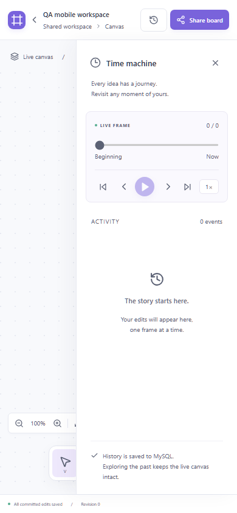
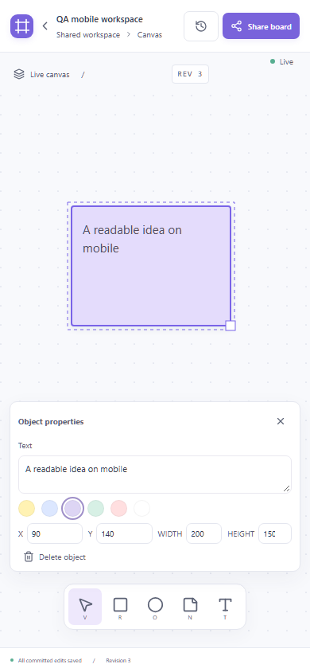

# 실제 브라우저 종합 QA

2026-10-24 KST. 실제 Docker Compose의 Go·MySQL·Redis·Kafka와 Chromium을 사용했다. 백엔드 응답이나 WebSocket을 가짜 구현으로 교체하지 않았다. 원시 결과는 [artifacts/browser-qa](https://github.com/whxodus0121/syncframe/tree/678c58e0a0c9bce89390bbe836b4514b3d1198e4/artifacts/browser-qa/)에 보존한다.

## 재현 명령

Windows PowerShell, 기본 포트 기준:

```powershell
./scripts/browser-qa.ps1
# 실행 ID를 지정하려면 기존 증거와 겹치지 않는 값을 사용
./scripts/browser-qa.ps1 -RunId my-browser-qa-run
```

기존 볼륨을 보존하고 두 API 인스턴스를 빌드·기동한 뒤 실제 DB/Go 검사, 프론트엔드, 전체 브라우저 E2E, 기존 Redis/Kafka/Go 장애 회귀를 순서대로 실행한다. 각 외부 명령의 exit code를 확인한다. 테스트는 임의 ID의 새 `QA ...` 보드를 생성하고 기존 보드를 삭제하거나 초기화하지 않는다. 실제 서비스 재시작이 포함되므로 개인 데모 편집 중에는 연결 중단이 발생한다.

브라우저 suite만 실행할 때:

```powershell
cd web
$env:QA_RUN_ID='unique-run-id'
npm run browser:qa
```

통합 PowerShell 스크립트는 UTC 밀리초 시각과 GUID를 QA_RUN_ID로 전달한다. 브라우저 suite를 직접 실행하고 QA_RUN_ID를 생략하면 UTC timestamp를 사용한다. 직접 실행한 실패 Trace를 Git에 보존하기 전에는 `scripts/sanitize-browser-traces.ps1`을 실행한다. 통합 스크립트는 자동 실행한다. Trace의 URL·쿠키·JSON 등에 포함된 로컬 테스트 capability를 가리고 DOM·입력·시각·네트워크 타이밍을 유지한다. 테스트 진단 로그도 capability를 가린다.

## 실행 결과와 증거 구성

대표 상세 원본은 publication-final-20261024 실행이다. Go 9개, frontend 5개, Chromium 13개(65.8s), 실제 Redis/Kafka/Go 장애 회귀(70.80s)가 통과했다. [E2E JSON](../artifacts/evidence/browser/results.json), [브라우저 로그](../artifacts/evidence/browser/browser-tests.txt), [장애 로그](../artifacts/evidence/browser/infrastructure-regression.txt), [환경](../artifacts/evidence/browser/environment.json)에 근거를 남긴다.

인수 없는 `./scripts/browser-qa.ps1`도 실제 재실행해 UTC 밀리초 시각과 GUID로 새 RunId가 생성되는지 확인했다. 이 실행의 Chromium 13개(67.4s)와 실제 장애 회귀(68.82s)도 통과했다. [명령 실행 기록](../artifacts/evidence/readme-command.json)은 이 실행을 별도로 구분한다.

[공개 증거 목록](../artifacts/README.md)은 대표 화면과 수정 전 초안 결함 Trace 하나를 제공한다. 반복 실행 전체는 정리 전 공개 커밋과 로컬 백업에 남아 있다. 현재 main에서 제외한 자료를 삭제된 증거로 해석하지 않으며, 전체 E2E의 attachment 경로는 원래 실행 메타데이터로 유지한다. 경량 CI는 이 브라우저·인프라 검사를 실행하지 않는다.

## 환경과 실제 입력

- 대상: **http://localhost:8080**, 보조 Go 서버 **http://localhost:8081**.
- 독립 Chromium context 3개, QA Alice / QA Bob / QA Cara. 이름만 sessionStorage에서 초기화하며 권한·문서·통신은 실제 서비스로 생성한다.
- 데스크톱 1440×960, 태블릿 768×1024, 모바일 390×844 viewport. 실제 모바일 장비나 터치 키보드 평가는 아니다.
- 브라우저·Node·Playwright 버전은 대표 environment.json에 기록한다. 각 실행의 전체 서비스 상태는 로컬 원본 실행 폴더에서 보존한다.
- 로딩 테스트는 실제 HTTP 요청을 보류한 뒤 `route.continue()`로 원래 Go 서버에 전송한다. 응답 본문·상태를 대체하지 않는다.
- Pause 검사는 브라우저 clock을 전진시켜 정지가 유지되는지 확인한다. 문서 상태/이벤트를 조작하지 않는다.

## 사용자 시나리오와 assertion

| 시나리오 | 판정 근거 |
|---|---|
| 메인·생성·기존 보드 | heading/빈 캔버스/객체, 홈 recent 링크 재진입, 새 탭 재접속 |
| 실제 공유 버튼 | Clipboard invite URL, 독립 context의 링크 권한 획득과 실제 객체 수 |
| 도형·노트·텍스트 | 도구 클릭과 좌표 입력, 생성 ID/Revision, 다른 브라우저의 SVG 객체/내용 |
| 이동·크기·색상 | transform/width/height/fill의 구체적인 값; 핸들, 80% zoom 드래그, 방향키/Delete |
| 3인·2개 서버 | A 생성→B/C 표시, B 이동→A/C 일치, 동시 text 수정 2개 event와 최종 커밋 값 수렴 |
| 작성 중 초안 | A의 textarea/width 입력 중 B 커밋; A 입력값 보존 및 blur 후 실제 event/B 화면 반영 |
| 커서·Presence | 실제 SVG 사용자 이름, online 3→2→3, 탭 종료/새 탭 재접속 |
| Offline·Online | Reconnecting/1 pending, 다른 사용자 추가 편집, 복구 후 객체/Revision, ID 중복 없음 |
| Go 재시작 | 실제 컨테이너 restart, 브라우저 Live 복귀, 원래 영속 state 유지 |
| Time machine | 0/이전/다음 Revision, 4개 속도, Play/Pause, overlay rect, Canvas 복귀 |
| 이력 격리 | B의 live 편집 중 A의 과거 Revision 불변, live 복귀 후 새 내용 표시 |
| Replay·SQL | 연속 Revision/ID 유일성, 전체 replay == API state == MySQL boards.state |
| 로딩·오류 | 최초 loading heading, history loading과 live 객체 미노출, 401 화면과 workspace 복귀 |
| Console·Network | 모든 페이지 오류 수집, 예상 외 항목은 실패; 의도적 Offline/401/재시작 오류만 분류 |
| 접근성·레이아웃 | axe A/AA, viewport overflow, 도구 노출, 실제 클릭·드래그·스크린샷 직접 검토 |

고정 sleep을 성공 판정으로 사용하지 않는다. DOM assertion, state polling, WebSocket으로 반영된 SVG와 실제 SQL 조회로 판정한다. 페이지 로딩이나 HTTP 200만으로 PASS 처리하지 않는다.

## 발견한 결함과 수정

| ID | 재현한 실패 | 원인과 수정 |
|---|---|---|
| B01 | 기존 보드를 새 탭에서 열면 Share 실패 | sessionStorage에만 키가 있음. 쿠키 권한을 검증한 same-origin POST /share에서 동일 capability를 명시적 공유 동작에 반환 |
| B02 | 동시에 입력한 text 하나가 저장되지 않음 | 원격 effect가 미전송 초안을 덮음. dirty text/숫자 초안을 로컬 유지하고 blur 시 각각 전송 |
| B03 | 좌측 객체가 속성 패널에 가려 드래그 실패 | 고정 좌측 배치. 데스크톱은 객체 반대편, 좁은 화면은 하단 편집 영역 |
| B04 | 모바일 초기 History가 캔버스·도구를 가림 | 항상 열린 초기 상태. 좁은 화면에서는 접고 시작 |
| B05 | 이력 중 Canvas 버튼 무동작 | 누락된 handler 추가, 재생/preview 종료 후 live 복귀 |
| B06 | Revision 0을 요청했는데 live 도형이 보임 | 과거 응답 대기 시 live fallback. loading과 빈 preview로 혼합 방지 |
| B07 | 모바일 빈 안내가 화면 밖, 활동 로딩을 빈 이력으로 표시 | viewport 기준 HTML 안내, 활동 loading 상태 표시 |

B01/B03/B04는 baseline, B05는 repro-controls, B02/B06은 repro-drafts-loading의 실패 Trace/이미지로 확인했다. B07은 렌더링된 모바일·활동 화면에서 확인했다. 각 결함의 assertion을 유지한 채 수정 후 재실행했다.

## 실패 실행의 해석

- baseline: 5 FAIL / 2 PASS. 속도 select 값에 대한 테스트 코드 오류도 포함되어 전부를 제품 버그로 세지 않았다.
- repro-controls: selector를 바로잡은 뒤 4 FAIL. Canvas 복귀와 화면별 조작 실패.
- repro-drafts-loading: 2 FAIL. 초안 소실과 history fallback의 결정적 재현.
- repair-1: 5 PASS / 2 FAIL. 초안 결함 및 desktop 패널 toggle 테스트 순서 수정.
- repair-2: 12 PASS / 1 FAIL. 초기 요청 보류 gate가 후속 검증까지 막던 테스트 코드 수정. 기능 삭제나 assertion 완화로 해결하지 않았다.
- repair-3: 13 PASS / 0 FAIL, 56.9s.
- final-20261024: 13 PASS / 0 FAIL, 59.8s.
- portfolio-final-20261024: **13 PASS / 0 FAIL, 59.3s**, 이후 실제 인프라 장애 회귀도 PASS(68.19s).

실패 Trace, 화면, 진단 JSON과 필요한 경우 Video는 원래 실행 폴더와 로컬 백업에 보존한다. 공개 main에는 [초안 덮어쓰기 Trace](../artifacts/evidence/failure-draft-overwrite/trace.zip) 하나를 대표로 두고, 예전 실패 결과를 최종 PASS로 덮어쓰지 않는다.

## 화면 비교

수정 전 desktop/tablet에서는 속성 패널이 객체를 가렸고 mobile에서는 History가 도구를 가렸다. 수정 후 캡처에서는 객체와 속성 패널이 분리되고 편집 도구가 viewport 안에 노출된다. 화면 비교와 실제 클릭·드래그 assertion을 함께 사용한다.

| 모바일 수정 전 | 모바일 수정 후 |
|---|---|
|  |  |

[데스크톱](../artifacts/evidence/screenshots/desktop.png) · [태블릿](../artifacts/evidence/screenshots/tablet.png) · [3세션 복구](https://github.com/whxodus0121/syncframe/blob/678c58e0a0c9bce89390bbe836b4514b3d1198e4/artifacts/browser-qa/screenshots/portfolio-final-20261024/three-session-recovery.png) · [이력 Overlay](../artifacts/evidence/screenshots/history-overlay.png) · [지연 응답](https://github.com/whxodus0121/syncframe/blob/678c58e0a0c9bce89390bbe836b4514b3d1198e4/artifacts/browser-qa/screenshots/portfolio-final-20261024/history-response-in-flight.png)

## 공개 시연 재현

공개 시연을 다시 생성하는 명령은 다음과 같다. GIF는 8개 실제 캡처의 상태 전환이고 WebM은 연속 브라우저 녹화다. 장면 간 1초 대기는 시청을 위한 간격이며 성공 판정은 DOM·SQL assertion을 사용한다.

```powershell
cd web
npx playwright test --config demo.config.ts
cd ..
python -m pip install Pillow==13.0.0
python scripts/make-demo-gif.py
```

데모 구성은 공개 이미지·영상을 같은 경로에 재생성하므로 이전 시연을 보존하려면 출력 폴더를 별도 복사한다. 회귀 테스트는 고유 QA_RUN_ID로 결과를 분리한다.

## 한계 / UNVERIFIED

- 실제 모바일 하드웨어·터치·가상 키보드, Firefox/WebKit, 스크린리더 사용성은 UNVERIFIED이다. 반응형 PASS는 위 3개 viewport의 마우스/키보드 조작 범위이다.
- 네트워크 장애는 Chromium Offline과 실제 서비스 재시작이다. 임의 WAN 손실·장시간 불안정 연결은 UNVERIFIED이다.
- 캔버스는 기존 1400×950 작업 영역이며 무한 pan/대형 보드를 검증하지 않았다. 작은 화면에서는 내부 스크롤을 사용한다.
- 하단 속성과 이력 패널은 화면 일부를 차지하며 닫아서 편집 공간을 넓힐 수 있다. 가상 키보드가 열린 상태는 별도 검증이 필요하다.
- 같은 텍스트 필드의 커밋은 마지막 서버 Revision 우선이다. 초안 보호를 문자 CRDT 병합으로 해석하지 않는다.
- 계정·키 철회·운영 HA는 구현 범위에 포함하지 않는다.
